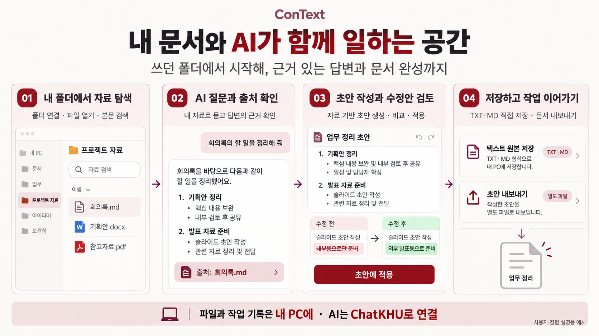

# 2. 핵심 아이디어와 사용자 경험

## 핵심 아이디어

**ConText는 ‘내 문서와 AI가 함께 일하는 공간’을 구현하는 로컬 기반 AI 문서 작업 공간이다.** 사용자가 평소 쓰던 PC 폴더를 연결하면, 자료 탐색부터 문서에 근거한 AI 질문, 초안 작성과 편집까지 하나의 환경에서 이어갈 수 있다. 파일을 찾아 AI에 전달하고, 답변을 다시 문서로 옮기는 반복을 줄여 사용자가 자료의 내용을 이해하고 결과물을 완성하는 데 집중하도록 돕는다.

핵심은 **‘내 자료를 찾고 → 근거를 확인하며 묻고 → 문서로 정리하는 경험’**이다. 파일과 작업 기록은 로컬에서 관리하며, AI 기능은 경희대 ChatKHU에 연결해 활용한다. AI 답변에는 근거가 된 문서를 함께 제공하고, 초안 수정은 사용자가 변경 내용을 확인한 뒤 적용하도록 구성한다.

## 주요 기능

- **쓰던 폴더에서 시작하는 자료 탐색:** 기존 폴더를 연결하고, 파일 탐색과 본문 검색으로 필요한 자료를 찾는다. 캔버스에서는 파일의 배치와 연결 관계를 살펴보며 작업 맥락을 파악한다.
- **내 자료에 근거한 AI 질문:** “회의록에서 담당자별 할 일을 정리해 줘”처럼 자연어로 요청하고, 답변과 함께 제시된 출처를 열어 원문을 확인한다.
- **자료 기반 문서 초안 작성:** 회의록을 업무 정리 초안으로, 메모를 체크리스트로 바꾸는 등 기존 자료를 새로운 결과물로 정리한다.
- **수정안 비교와 사용자 선택:** 초안의 문장을 AI로 다듬고 수정 전후를 비교한다. 사용자가 원하는 변경을 검토해 적용하거나 거절한다.
- **저장과 후속 작업:** TXT·Markdown은 텍스트 편집기에서 원본에 직접 저장하고, 다른 형식의 자료는 새 초안으로 편집해 별도 파일로 내보낸다. 파일 이력과 비교·복원 기능으로 작업 내용을 확인한다.

## 사용자 스토리 및 화면·체험 순서

팀 프로젝트 발표를 준비하는 대학생이 회의록, 기획안, 참고자료를 바탕으로 업무 정리 문서를 작성하는 상황을 대표 시나리오로 설정한다.

| 단계 | 화면과 사용자 행동 | 제공하는 경험 |
| --- | --- | --- |
| ① 시작 | ConText를 실행하고 프로젝트 폴더를 연결한다. AI 기능을 사용할 ChatKHU 연결을 설정한다. | 익숙한 자료를 바탕으로 작업을 시작한다. |
| ② 자료 탐색 | 작업 공간에서 회의록과 기획안을 열고, 본문 검색으로 필요한 내용을 찾는다. | 여러 자료를 같은 작업 공간에서 살펴본다. |
| ③ AI 질문·근거 확인 | “회의록의 할 일을 담당자별로 정리해 줘”라고 요청하고, 답변의 출처를 눌러 원문을 확인한다. | 답변의 근거를 직접 확인하며 내용을 판단한다. |
| ④ 초안 작성·수정 | 자료를 바탕으로 업무 정리 초안을 만들고, 문장 수정안을 비교해 원하는 변경을 적용한다. | 정리와 작성의 부담을 줄이고 최종 판단은 사용자가 한다. |
| ⑤ 저장·작업 계속 | 완성된 초안을 파일로 내보낸다. TXT·Markdown 원본은 직접 편집해 저장할 수 있다. | 결과물을 익숙한 파일 작업으로 이어간다. |

*그림 1. 자료 탐색 → AI 질문과 출처 확인 → 초안 작성·수정 → 저장으로 이어지는 사용자 경험. 화면과 문서 내용은 설명용 예시이다.*

이 경험을 통해 사용자는 흩어진 자료를 찾는 단계부터 근거 확인과 문서 완성까지 작업의 흐름을 유지할 수 있다. ConText는 자신의 자료를 이해하고 활용하는 과정을 돕는 개인 문서 작업 환경을 지향한다.

---

작성 기준: 저장소의 현재 제품 방향(`docs/product-direction.md`, 2026-10-28)과 소개 자료. AI 답변·초안 생성에는 인터넷과 외부 AI 연결이 필요하며, 관련 발췌문이 연결 서비스로 전송된다. 채팅에서 제안한 변경을 비교해 같은 원본 파일에 바로 적용하는 통합 흐름은 후속 개발 범위이다.
