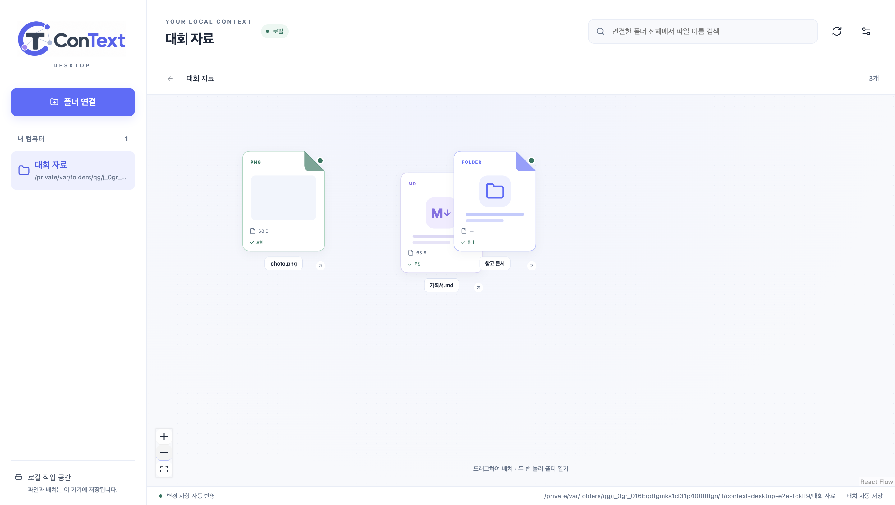

# ConText 웹 + 데스크톱 개발 목표

> 2026-10-25 현재 구현: 웹과 데스크톱의 공통 작업 환경, 로컬 문서 편집·저장, 서버/개인 ChatKHU 연결과 동기화 확장 기반은 [공통 환경 실행 계획](desktop-web-parity-plan.md)을 따른다. 최신 결과는 [진행 기록](desktop-web-parity-progress.md)과 [검증 기록](desktop-web-parity-verification.md)에 있다. 아래 내용은 기존 1차 구현의 역사적 범위와 검증 기록이다.

## 제품 방향

웹은 서버 저장·협업·AI 문서 작성 서비스를 계속 제공합니다. 별도 데스크톱 앱은 사용자가 연결한 로컬 폴더를 ConText 캔버스로 보여 줍니다. 공통 문서 카드와 디자인 토큰을 재사용하고 파일 접근과 저장은 환경별로 분리합니다. 3D UI는 범위에 포함하지 않습니다.

## 1차 목표: 로컬 작업 공간

| 항목 | 구현 |
|---|---|
| 독립 앱 | `apps/desktop`의 Electron + Vite. 웹과 별도 실행·빌드 |
| 공통 UI | `frontend/shared/ui/document-paper.tsx`와 CSS, 색상·브랜드 자산 공유 |
| 폴더 연결 | 네이티브 폴더 선택, 여러 작업 공간, 하위 폴더 탐색 |
| 파일 표시 | 종류별 문서 카드, 이미지 썸네일, 파일 메타데이터 |
| 탐색 | 하위 폴더·경로 이동, 전체 파일 이름 검색, 200개씩 추가 표시 |
| 로컬 배치 | SQLite 좌표·화면 위치 저장, 재시작 복원, 새 파일이 기존 배치를 밀지 않음 |
| 변경 감지 | chokidar, 이벤트 합치기, 제한 시 polling, 주기적 재확인 |
| 외부 파일 열기 | 제한된 형식의 OS 기본 앱 실행, 탐색기에서 원본 보기 |
| 연결 복구 | 접근 불가 시 캐시 목록 유지, 새 위치 지정 |
| 연결 해제 | 확인 후 내부 인덱스만 제거, 원본 유지 |
| 배포 기반 | macOS 앱 생성, Windows NSIS 설정 |

사용 방법과 구체적인 제한은 [데스크톱 안내](../apps/desktop/README.md)에 있습니다. 작업 공간당 25,000개 제한과 기본 제외 항목을 UI·안내에 명시합니다. 모든 파일 형식의 본문 파싱을 제공하는 단계는 아닙니다.

## 검증 기록

2026-10-19 기준 로컬 엔진 7개, 실제 Electron 통합 1개, 웹 캔버스 40개 테스트가 통과했습니다. 최종 패키징된 앱으로도 통합 테스트를 실행했습니다.

- 로컬 엔진: 폴더 재귀 스캔, 설정, 0바이트 파일, 이름 교환/변경, 교체 저장, 재시작, 파일 감시, 연결 해제 원본 보존, 경로 이탈 차단, 안정적인 초기 배치.
- 실제 Electron: 폴더 선택, 이미지/텍스트 미리보기, 하위 폴더, 전체 이름 검색, 외부 파일 변경, 드래그, 줌, 재실행 복원, 렌더러 Node 차단, 연결 해제.
- 웹: 타입 검사·린트·프로덕션 빌드, 데스크톱/모바일 캔버스 회귀 40개.
- 패키징: macOS Apple Silicon 앱 생성 및 실제 실행. 서명/공증·Windows 실행 검증은 별도 작업.
- 의존성 검사: 추가한 패키징 도구의 전이 의존성 `sprintf-js` 관련 moderate 경고 8건(상위 패키지 중복 포함)이 남아 있습니다. 무관한 버전 강제 변경은 하지 않았습니다. 외부 배포 전 빌드 도구 업데이트를 재확인합니다.

## 2차: 로컬 문서를 AI가 참고해 작성

1. 기존 백엔드의 문서 파싱을 재사용 가능한 단위로 분리하고 PDF/DOCX/HWPX 텍스트를 로컬 Worker에서 추출합니다. HWP는 별도 파서 또는 변환 경로를 결정합니다.
2. 파일 변경 시 해당 문서만 갱신하는 로컬 전문 검색을 추가합니다. SQLite FTS5를 먼저 사용하고, 필요할 때 임베딩·벡터 검색을 결합합니다.
3. 사용자가 요청하면 연결된 작업 공간의 관련 자료를 자동 검색하고, 참조한 파일·문단을 UI에 표시합니다. 연결하지 않은 컴퓨터 전체는 탐색하지 않습니다.
4. Mindlogic API Gateway 호출을 서버 중계 또는 사용자별 인증 방식에 연결합니다. 공용 비밀 키를 Electron 번들에 넣지 않습니다. 원격 모델에 전달할 자료 범위를 UI에서 알 수 있게 합니다.
5. 기존 Editor.js 문서 모델을 공통 모듈로 분리합니다. AI 초안을 캔버스에서 편집하고 DOCX/HWPX 내보내기와 로컬 저장을 연결합니다.

완료 기준: 폴더 연결 후 파일을 일일이 지정하지 않고 요청 → 관련 근거 표시 → 편집 가능한 초안 → 로컬 문서 저장까지 실제로 이어지는 시연.

## 3차: 배포와 선택적 웹 연동

- 대규모 폴더 증분 색인, 스캔 취소·진행률, 오랜 실행 중 메모리·감시 자원 측정.
- Windows/macOS 설치 파일, 서명·공증, 자동 업데이트, OS별 회귀 테스트.
- 사용자가 고른 문서만 웹으로 보내는 업로드와 계정 연결.
- 필요 시 충돌 정책·버전 관리·오프라인 편집을 포함한 양방향 동기화. 단순 업로드와 자동 동기화를 구분해서 설계합니다.

AI 연결과 동기화는 1차 구현에 포함됐다고 표시하지 않습니다. 현재 웹 기능은 기존 서버를 통해 계속 사용할 수 있습니다.
