# 웹·데스크톱 공통 환경 검증

검증일: 2026-10-26 (한국 시간). 환경: macOS Apple Silicon, Node 24.18.0, Electron 44.9.0, Next.js 16.4.3, 빌드용 Python 3.12.14. 원본 작업과 테스트 자료는 분리했다. 기존 자료를 테스트 초기화 대상으로 쓰지 않았다.

## 데스크톱 카드 형식 변환·실제 복사본 검증 (2026-10-26)

웹의 카드 변환·복사 UI를 공통 컴포넌트로 옮기고 웹 HTTP/데스크톱 IPC 어댑터를 연결했다. 웹의 PDF·DOCX·TXT·Markdown과 데스크톱의 HWPX 포함 5종 출력을 유지한다. 변환 결과는 앱에 보관한 뒤 네이티브 저장 창으로 저장하며, 일반 파일 복사본은 같은 물리 폴더에 독립된 파일로 만든다. 로그인·네트워크·사용자 원문 업로드 없이 수행한다.

| 실행 범위 | 결과 | 로그 |
|---|---|---|
| 최종 로컬 단위·통합 | 73 passed, 순차 실행 | `/private/tmp/context-derivatives-all-unit-final.log` |
| 한글 파일명 길이 경계 보완 후 변환·복사 | 9 passed | `/private/tmp/context-derivatives-unit-boundary.log` |
| 개발 Electron 변환·복사 UI | 1 passed | `/private/tmp/context-derivatives-ui.log` |
| 최종 패키징 macOS 앱 전체 | 20 passed, 1.4m | `/private/tmp/context-derivatives-packaged-final.log` |
| 웹·모바일 변환·다운로드·복사 | 17 passed, 모바일 호버 전용 1 skip | `/private/tmp/context-derivatives-web-e2e-final.log` |
| 데스크톱 타입·빌드·파서 검사·패키징 | 통과 | `/private/tmp/context-derivatives-pack-final.log` |
| 웹 타입·전체 린트 | 통과 | `/private/tmp/context-derivatives-web-types-final.log`, `/private/tmp/context-derivatives-web-lint-final.log` |
| 웹 프로덕션 빌드 | 통과 | `/private/tmp/context-derivatives-web-build-final.log` |

신규 단위/로컬 통합 검사는 번들 파서를 통한 실제 한글 5종 변환·저장, 수정 이력/형식별 재사용, 과거 이력 변환과 현재 head 보존, 손상 캐시 검출·명시적 재시도, 앱 중단 후 재개, 전체 폴더 해제 후 늦은 결과 폐기를 확인한다. SQLite 7 → 8은 일관된 백업과 문서·좌표 보존을 검사했다. 변환 결과는 작업 공간에 종속된 SQLite BLOB이며 원본 파일이나 새 문서를 자동 생성하지 않는다.

복사는 디스크 원본이 파싱 불가 상태가 되어도 고정 이력의 저장 바이트를 우선하는 동작, 문서의 현재/고정 이력, 이미지/바이너리·빈 파일, 별도 ID·inode와 수정 독립성, 한글 긴 이름·동시 이름 충돌, 중복 요청, 게시 직후 중단·재시작 복구, 읽기 전용 폴더·원본 변경·다른 파일의 이력·링크/폴더·연결 해제 거부를 검사했다. 임시 파일은 숨김 표시 여부와 무관하게 목록·색인에서 제외한다. 복사본의 이력 출처는 `source_version_id`와 로컬 변경 기록에 남기며 기기별 경로·작업 캐시는 outbox에 싣지 않는다.

패키징 앱 UI는 실제 main/preload/worker·SQLite·번들 파서·디스크 파일을 사용하며 파일 선택/저장 대화상자만 테스트 위치로 응답하게 했다. 카드의 5종 패널, 변환 중 패널 닫기, 저장 취소 후 결과 유지, DOCX 실제 바이트 저장, 문서/이미지 복사, 원본과 별도 수정, 중첩 폴더의 수정 상태에서 복사와 원본 옆 배치, 재실행 후 변환 결과 복원, 미리보기 내보내기와 기록 공유를 확인했다. 인접 카드가 열린 패널을 가리지 않으며 아이콘 사이 이동 영역이 주변 카드를 덮지 않도록 보완했다.

첫 웹 회귀의 실패 3개는 이전에 제거한 `.paper-glyph`를 찾던 호버 검사였다. 현재 `.paper-sheet`로 검사 대상을 맞춘 뒤 전체 17개가 통과했다. 새 데스크톱 UI 검사에서는 닫기 후 초점과 인접 카드의 포인터 차단을 찾아 수정했다. 기존 사용자 파일·DB·환경 파일과 Docker 데이터는 검증 자료로 변경하지 않았다. 파서/백엔드·의존성·웹 API는 변경하지 않았다. 변환은 원본 이미지·정밀 배치를 복원하지 않으며 실제 Windows 실행과 서명·공증·운영 배포는 이번 범위에 포함하지 않는다.

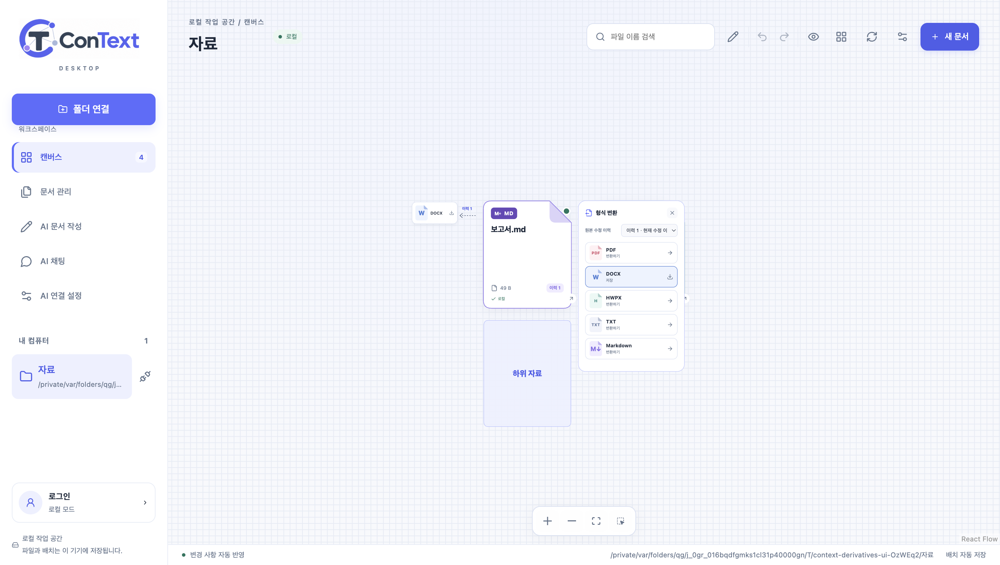

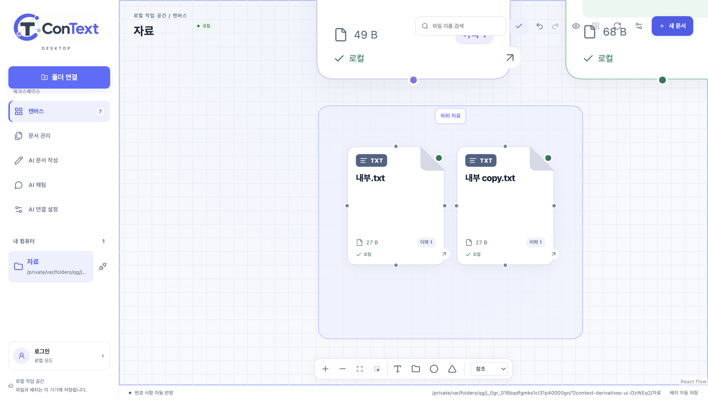

## 데스크톱 선택적 계정 로그인 검증 (2026-10-26)

폴더 연결 전후에 왼쪽 아래 로그인/계정 관리를 제공한다. 기본 API는 사용자 선택에 따라 `http://127.0.0.1:8000`이며 앱에서 변경할 수 있다. 웹과 같은 Google/Supabase 인증을 시스템 브라우저 PKCE·임시 loopback callback으로 완료한 뒤 ConText `/api/me`에서 검증한 application user UUID·이메일·이름을 사용한다. 일반 계정과 기본 ChatKHU는 기존 암호화 세션을 공유한다. 개인 AI 키·모델과 기기의 원본·폴더 연결·배치·초안·대화는 유지한다.

| 실행 범위 | 결과 | 로그 |
|---|---|---|
| 최종 로컬 단위·통합 | 63 passed, 순차 실행 | `/private/tmp/context-account-all-unit.log` |
| 개발 Electron 로그인 UI | 2 passed | `/private/tmp/context-account-ui.log` |
| 최종 패키징 macOS 앱 전체 | 19 passed, 1.2m | `/private/tmp/context-account-packaged.log` |
| 데스크톱 타입·빌드·독립 파서 검사·패키징 | 통과 | `/private/tmp/context-account-pack.log` |
| 웹 타입·전체 린트 | 통과 | `/private/tmp/context-account-web-types.log`, `/private/tmp/context-account-web-lint.log` |

새 단위 검사는 검증된 웹 사용자 ID·PKCE challenge·암호화 파일/IPC의 토큰 비노출, 기존 AI 계정 프로필 이전, 세션 회전 중복 방지, 오프라인/만료, 서버 변경, 로그아웃 이후 늦은 응답 무시, 보안 저장소 읽기 중 조기 취소, 잘못된 프로필/토큰 응답 거부를 확인한다. 패키징 UI는 실제 main/preload/renderer·OS 보안 저장소·임시 callback 서버를 사용한다. Google와 Supabase 토큰 교환·서버 사용자 응답만 합성 대역으로 바꾸며 런타임 인증 우회나 테스트 계정을 앱에 추가하지 않는다. 로그인 없는 폴더 사용, 취소/오류 후 로컬 계속, 로그인 후 같은 파일 ID·좌표, 앱 재시작 후 계정/배치 복원, 이 기기만 로그아웃과 원본 보존을 확인했다. 로그인 대화상자는 내용 높이로 중앙에 배치한다.

실제 로컬 서버 `/api/desktop/auth/config`는 200이며 개발·운영 웹 설정과 같은 Supabase 프로젝트를 사용하는 것을 값 출력 없이 확인했다. 공개 authorize 시작은 Google provider로 302를 반환했다. 사용자 계정 없이 해당 요청에 대한 `access_denied` callback을 완료하자 임의 포트·경로의 데스크톱 loopback 주소로 302가 반환됐다. 현재 프로젝트의 callback 허용은 확인했으며 실제 사용자의 Google 계정 선택·동의·토큰 발급 완료는 수행하지 않았다. 웹/운영 주소나 인증 프로젝트를 바꾼 경우 allowlist를 다시 확인해야 한다.

로그인으로 자동 웹 동기화·업로드·원격 작업 공간 생성은 시작하지 않는다. 기기별 자료를 계정에 자동 귀속하지 않으며 후속 계정 binding 원칙은 [동기화 계약](local-sync-contract.md)에 남겼다. 이번 변경에는 웹 런타임 UI·백엔드·문서 파서 변경이 없어 이전 웹 통합/프로덕션 빌드 결과와 구분한다.

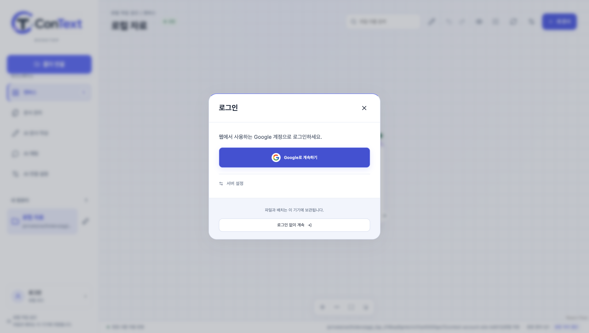

[테스트 계정으로 확인한 계정 관리 화면](images/desktop-account-signed-in.png)

## 캔버스 상호작용 후속 검증 (2026-10-26)

웹과 데스크톱은 공통 제스처·폴더 가시성·추가 배치·모션을 사용한다. 트랙패드 스크롤은 두 축 이동, 핀치/Ctrl·⌘+휠은 확대다. 중첩 폴더는 누적 지역 배율 .42에서 열고 .34 이하에서 접으며 수정 상태에서도 한 번 클릭해 연다. 클릭 목표 .55와 추가 확대 한도를 구분하고 내부 파일의 축소율까지 반영한다. 데스크톱은 깊은 확대 화면을 저장·복원한다.

AI 패널은 280ms 오른쪽 전환과 캔버스 폭 전환을 함께 처리한다. 닫힘이 끝날 때까지 컴포넌트를 유지하고 즉시 inert/aria-hidden을 적용한다. 빠른 열기·닫기 반전, 질문 초안·대화 유지, 모션 감소 설정, 왼쪽 AI 메뉴로 초점 복귀를 확인했다. 참조 요청은 중복하지 않고 크기 전환 종료 후 한 번 초점을 맞춘다. 제한된 데스크톱 장면의 기존 항목을 유지해 주변 파일 DOM·배치·연결선이 사라지지 않는다. 웹 우측 AI 호출 아이콘은 제거했다.

텍스트는 배치를 밀거나 폴더 크기를 바꾸지 않는다. 새 파일·폴더 추가는 간격 24·개별 이동 최대 160·영향 최대 8개로 같은 행의 이웃만 움직이며, 초과하면 새 항목만 빈 공간에 둔다. 폴더 그룹의 자식과 부모 경계를 보존하며 240ms 이동·320×240 빈 논리 폴더·호버 시 위치/크기 불변을 검사했다. 초기 로드·재로딩·외부 감시에 삽입 동작을 적용하지 않는다. 생성 직전 기존 물리 폴더의 자동 배치를 고정한다.

새 텍스트 파일, 업로드와 업로드 확인 복구, 복사본, 선택 요약을 배치 저장에 연결했다. 실패 시 원래 배치로 보상하고 재시도 중복을 막는다. 배치 undo/redo는 실제 생성한 파일을 삭제하지 않으며 재시작 후 원문도 보존한다.

| 실행 범위 | 결과 | 로그 |
|---|---|---|
| 최종 로컬 단위·통합 | 55 passed, 순차 실행 | `/private/tmp/context-motion-unit-final.log` |
| 최종 패키징 macOS 앱 전체 | 17 passed, 1.2m | `/private/tmp/context-motion-packaged-final.log` |
| 웹·모바일 요소·업로드·AI 통합 회귀 | 73 passed, 1 모바일 트랙패드 전용 skip, 2.7m | `/private/tmp/context-motion-web-final.log` |
| 추가 확대 보완 후 폴더 탐색 | 6 passed | `/private/tmp/context-motion-zoom-final.log` |
| 업로드 확인 복구 보완 후 | 12 passed | `/private/tmp/context-motion-documents-final.log` |
| 웹·모바일 이동·연결·선택 요약 | 40 passed | `/private/tmp/context-motion-canvas.log` |
| 복사본 배치·내용·다시 열기 | 2 passed | `/private/tmp/context-motion-copy.log` |
| 최종 웹 프로덕션 빌드·타입·린트 | 통과 | `/private/tmp/context-motion-web-build-final.log`, `context-motion-web-types.log`, `context-motion-lint.log` |
| 최종 데스크톱 빌드·파서 검사·패키징 | 통과 | `/private/tmp/context-motion-pack-final.log` |

후속 확대/복구 검사는 통합 회귀와 겹치므로 숫자를 합산하지 않는다. 병렬 검사 중 파일 감시와 테스트 서버 기동에 각각 한 차례 시간 초과가 있었다. 같은 소스에서 실행 부하를 낮춘 재검사는 모두 통과했으며 감시기 자체를 수정한 결과로 표시하지 않는다. 실제 사용자 파일·DB 대신 임시 폴더·프로필과 API 대역을 사용했다. 웹 운영 배포와 Windows 실행은 이번 검증에 포함하지 않는다.

화면: [깊은 물리 폴더와 수정 도구](images/desktop-nested-motion.png), [겹침 메모와 새 항목](images/desktop-canvas-motion.png), [웹 중첩 폴더](images/web-nested-motion.png), [모바일](images/mobile-nested-motion.png), [오른쪽 AI 패널과 왼쪽 호출 메뉴](images/web-drawer-motion.png).

## 직전 캔버스 변경 검증 (2026-10-26)

- 직속 파일·하위 폴더 합계 8개부터 1093×793 영역을 유지하고 내부 항목을 비례 축소한다. 0·7·8·9·32개, 중첩, 음수 좌표, 좌표 왕복, 렌더링 범위와 전체 개수의 차이를 검사했다. 웹은 원래 저장 도형으로 소속을 계산하며 표시 좌표로 드롭 대상을 찾는다.
- 편집 전후 박스·카메라·펼침 상태를 유지한다. 확대해서 보이던 파일 이동, 실제 폴더로 드롭, 웹 박스 전체와 내부 파일의 그룹 이동, 저장·다시 열기·undo/redo를 확인했다.
- 하단 공통 도구의 오른쪽 확장·중앙 정렬·모바일 내부 스크롤, 큰 파일 아이콘/설명/데스크톱 경로 행/좌측 새 파일 버튼 제거를 확인했다. 원문과 기존 AI 참조·문서 연결·파일/폴더 연결 해제도 회귀 검사했다.

| 이번 실행 | 결과 | 로그 |
|---|---|---|
| 데스크톱 단위·로컬 통합 | 48 passed | `/private/tmp/context-canvas-unit.log` |
| 최종 공간 배치·중첩 좌표 | 10 passed | `/private/tmp/context-canvas-layout-test.log` |
| 최종 패키징 앱 전체 | 16 passed, 1.1m | `/private/tmp/context-canvas-packaged-e2e.log` |
| 웹·모바일 폴더/요소/도구 | 38 passed, 1.2m | `/private/tmp/context-canvas-web-e2e.log` |
| 웹·모바일 캔버스·연결·선택·저장 실패/재시도 | 40 passed, 1.4m | `/private/tmp/context-canvas-web-canvas.log` |
| 웹·모바일 통합 AI·검색·참조 | 14 passed, 31.5s | `/private/tmp/context-canvas-web-rag.log` |
| 웹 프로덕션 빌드 | 통과 | `/private/tmp/context-canvas-web-build.log` |
| 타입·린트·데스크톱 패키징 | 통과 | `/private/tmp/context-canvas-web-types.log`, `context-canvas-lint.log`, `context-canvas-pack.log` |

테스트는 임시 폴더와 API 대역을 사용했다. 실제 사용자 원문·DB는 테스트 초기화 대상으로 사용하지 않았다. 서버 API와 DB 스키마는 변경하지 않았다. 과거 검증 결과는 아래에 별도 보존한다.

화면: [데스크톱 32개 폴더](images/desktop-capped-folders.png), [웹](images/web-capped-folders.png), [모바일](images/mobile-capped-folders.png).

## 이전 단계 검증 결과

| 범위 | 명령·결과 | 로그 |
|---|---|---|
| 데스크톱 타입·빌드·패키징 | `npm run pack` 통과. processor fingerprint·현재 OS·라이선스·5종 출력 검사 포함 | `/private/tmp/context-reference-pack.log` |
| 데스크톱 단위/통합 | `npm test`: 참조의 기존 배치 유지·범위 밖 인용을 포함해 46 passed, 0 skipped | `/private/tmp/context-reference-unit.log` |
| 실제 패키징 앱 | 참조 더 보기·주변 파일/메모/박스 보존·화면 복원을 포함한 전체 15 passed (약 1.1m) | `/private/tmp/context-reference-packaged.log` |
| 백엔드 전체 | 이전 공통화 단계의 전용 테스트 DB `pytest -q`: 213 passed | `/private/tmp/context-parity-backend-tests.log` |
| 웹 정적 검사 | 참조 접기 변경 후 전체 타입·변경 파일 린트 통과. 프로덕션 빌드는 이전 공통화 단계 결과 | `/private/tmp/context-reference-web-typecheck.log`, `context-reference-web-lint.log`, `context-spatial-web-build.log` |
| 웹 공통 요소 추가 회귀 | 공통 상단 변경 후 데스크톱/모바일의 검색·메뉴·편집 전환 4개 통과 (19.5s). 이전 라벨/리사이저 회귀 4개도 별도 보존 | `/private/tmp/context-header-web-e2e.log`, `context-readable-web-elements.log` |
| 웹 로그인·주 화면 | `npm run test:e2e`: 10 passed | `/private/tmp/context-web-main.log` |
| 웹 문서·캔버스 | `npm run test:phase4`: 52 passed | `/private/tmp/context-web-phase4.log` |
| 웹 캔버스·도형/폴더 | `test:canvas`: 40 passed, `test:elements`: 22 passed | `/private/tmp/context-web-canvas.log`, `context-web-elements.log` |
| 웹 편집·AI 설정 | `npm run test:writing`: 14 passed | `/private/tmp/context-web-writing.log` |
| 웹 검색·채팅 | `test:rag`: 기본 접힘·더 보기·인용 자동 펼침·화면 이동 방지 등 웹/모바일 14 passed (40.6s) | `/private/tmp/context-reference-web-e2e.log` |
| 웹 후보·버전 | `test:intelligence`: 18 passed, `test:versions`: 10 passed | `/private/tmp/context-web-intelligence.log`, `context-web-versions.log` |
| 웹 변환 | `test:conversion`: 17 passed, 1 모바일 hover 전용 skip | `/private/tmp/context-web-conversion.log` |
| PDF 출력 시각 검사 | 한글·긴 줄·목록·3페이지 표·반복 표 머리글·쪽번호를 렌더링해 전 페이지 확인 | `/private/tmp/context-parity-pdf/tmp/pdfs/parity-export-sample.pdf` |
| 합성 부하 | 파일 2,012개·20폴더·4,812본문 구간, 검색·재시작 증분 색인 확인 | `/private/tmp/context-desktop-benchmark.json` |

웹 테스트 묶음에는 중복 시나리오가 있으므로 통과 수를 합산하지 않는다. 서로 다른 Playwright 설정은 같은 3100 포트를 써서 순서대로 실행했다. E2E의 사용자/권한/API 대역 검사는 실제 운영 로그인 완료를 의미하지 않는다. 백엔드에는 기존 anyio deprecation 경고 1개가 있으며 실패는 없다. Vite의 `use client` 제거 경고는 클라이언트 전용 번들에서 발생한다.

## 기능별 근거

공통 `WorkspaceHeader` 추출 단계에서 웹 타입·변경 파일 린트와 검색/메뉴·편집 전환 4개를 검사했다. 이번 상단까지 이어지는 캔버스와 투명 오버레이 변경은 데스크톱에 한정한다. 웹·백엔드·로컬 엔진 결과는 앞선 단계의 검증이며 이번 배치 변경으로 다시 실행하지 않았다.

| 기능 | 구현과 검사 | 제약 |
|---|---|---|
| 같은 작업 환경 | 공통 주 메뉴/헤더·문서 카드·캔버스 surface/도구·미리보기·이력/비교/후보·출처·편집기·AI 설정·채팅을 양쪽이 실제 import | 웹 팀/권한과 데스크톱 폴더/파일 작업은 환경별 어댑터 |
| 폴더·이미지·배치 | 실제 폴더를 같은 캔버스의 중첩 영역으로 표시, 축소/확대·진입·전체 이동·한글/공백 경로·외부 이름 변경·scope·배치·뷰포트·재시작 유지 | 논리 폴더는 웹과 같은 공간 그룹이며 디스크 경로를 바꾸지 않음 |
| 읽기·색인 | TXT/MD/PDF/DOCX/HWPX 독립 파싱, immutable 버전·한글 FTS trigram 및 1–2글자 보완 검색, 중단/재개·취소·변경 없는 파일 건너뛰기 | 문서 50MB, HWP 바이너리/OCR/정밀 원본 레이아웃 편집 제외 |
| 작성·직접 편집 | 공통 블록 편집·revision·AI 제안 적용/거절·되돌리기·재시작, UTF-8 BOM/CRLF·충돌 거부·별도 출력 | 직접 원본 편집은 2MB 이하 TXT/MD, 혼합 EOL은 CRLF로 정규화 |
| 안전한 저장 | DB 백업·순차 마이그레이션·파일 journal·중단 복구·해시 CAS·경쟁 파일 보존·이름 충돌 | 실제 파일 이동은 연결 범위의 같은 볼륨, 다른 볼륨은 OS 탐색기 사용 |
| 파일 작업 | 새 빈 TXT/MD·다른 이름 저장·이름 변경·이동·네이티브 휴지통, 캔버스의 물리 폴더 드롭·파일별 undo/redo·중복 이름 보존, 숨김/제외 경로 거부·경로 재검사 | 연결 해제는 앱 자료 정리, 원본/출력/이전 백업/복구 임시 자료 유지 |
| 버전·비교·후보 | 현재 관측 파일과 pinned 현재 이력 분리, 수동 연결과 출처 UUID, 실제 원본 복원 전 스냅샷, 공통 diff·변경 요약 근거 이동 | 후보는 웹의 동일 filename/trigram 계산, 임베딩은 추가하지 않음 |
| 검색·인용 | 현재/과거/기준일, 한국 시간 자정·잘못된 날짜/미래 거부, 삭제된 원본의 과거 스냅샷 열기·문단 강조 | 최초 색인 이전의 이력은 생성하지 않음 |
| 캔버스 | 메모·도형·논리 폴더·관계·다중 선택, 위치/관계/연결 방향의 undo/redo·재시작, AI 출처 강조 | 참조 보기의 임시 배치는 저장하지 않음 |
| AI 작성·요약·대화 | 문서·메모·최근 완료 대화·다른 초안의 제한된 문맥, 출처 검증, 로컬 대화 보관·선택 요약 파일/관계·결과 저장 재개 | 요청 처리 불명확 시 자동 재전송하지 않으며 수동 새 요청은 추가 과금 가능 |
| 내보내기 | 파서 묶음에서 DOCX/HWPX/PDF/TXT/MD 출력 후 재파싱·한글/표 대조, PDF 시각 검사 | 추출 본문 중심, 원본 이미지/배치 무손실 보존을 보장하지 않음 |
| 격리·확장 기반 | 렌더러 Node 접근 차단·IPC 허용 목록·작업 공간 ID 범위·경로/링크 거부, metadata/outbox/device 순번의 원자적 롤백 | 실제 sync transport·서버 충돌 병합은 구현 범위 밖 |

## 패키징 앱의 시나리오

1. 폴더 연결·이미지 미리보기·감시·배치·재시작·렌더러 격리.
2. 공통 Editor.js로 오프라인 초안 생성·실제 DOCX 저장·재시작 복원.
3. 통합 AI 입력으로 로컬 본문 검색·AI 미설정 시 원문 열기·인용 버전 비교·원본 복원.
4. UTF-8 직접 편집·이력·외부 변경 충돌 거부·네이티브 이름 변경.
5. 공통 텍스트/사각형 폴더·속성·관계·연결 방향·되돌리기/다시 실행·재시작.
6. 선택 요약 파일·출처 관계·새 카드의 크기 관측 알림이 지연돼도 연결선 표시·공통 채팅·참조 강조·삭제된 원본의 인용 스냅샷·대화 복원.
7. 수동 이력 연결·현재 지정·검색 변경·AI 변경 요약의 diff 근거 이동·원본 불변.
8. 실제 Electron OS 보안 저장소에서 합성 개인 키 암호화·종료/재시작 후 복호화·삭제. 이 검사는 네트워크를 호출하지 않는다.
9. 실제 폴더 영역의 축소/확대·중첩 진입·동일 캔버스 유지·메모·내부 영역 선택·배치 undo/redo·박스 배경을 끌어 영역 전체 이동·두 차례 재시작·모아 정렬/되돌리기·원본 불변.
10. 9개 자동 폴더 영역이 가까운 여러 행으로 배치되고 모두 한 화면 안에 표시됨.
11. 긴 한글/공백 폴더 이름 전체 표시, 혼합 화면에서 파일과 폴더 대표 카드의 실제 가로·세로 일치와 비겹침, 확대한 파일 이동/되돌리기, 폴더 진입 후 전체 이름 표시와 원본 보존.
12. 편집 시작/종료 전후 박스 크기·위치·카메라·펼침 상태 유지, 손잡이 부재·대표 카드 자체 드래그와 배치 되돌리기, 파일 드롭 강조·실제 디스크 이동·되돌리기/다시 실행, 이름 충돌 시 양쪽 내용 보존, 편집 모드·이동 결과 재시작 복원.

13. 미리보기에서 문서 연결 해제·새 검색에서 제외·문서 관리에서 이미지 해제·재시작 후 해제 목록 유지·문서/이미지 다시 연결·같은 ID/이력/배치/원본 내용 복원.

14. 내 컴퓨터에서 연결 폴더 전체 해제·취소·다른 연결 폴더와 현재 초안 보존·현재 폴더 해제 후 남은 폴더 열기·마지막 해제와 재시작·원본 및 중첩 원본 보존.

15. 물리 폴더 안의 참조 파일 확대 시 주변 파일·메모·폴더 박스/상대 좌표와 경로 유지. 6번 시나리오에서 참조 기본 접힘/펼침·인용 자동 펼침·주변 파일 DOM/연결선·카드 좌표/크기·저장 카메라 불변·확대 전 화면 복원도 검사한다.

16. 32개 파일 폴더에서 8개 상한 프레임·확대로 드러난 내부 파일의 수정/이동·카메라 불변·가운데 하단 도구·아이콘/설명 제거·원문 보존.

AI 기능 E2E는 유료 호출 경계에 합성 응답 대역을 설치한다. 파일 생성·출처 검사·SQLite·IPC·공통 화면·실제 frozen 파서는 실행한다. 네이티브 대화상자는 테스트 임시 경로로 응답한다. 배포 코드에는 테스트 우회 경로를 넣지 않았다.

## 실제 AI와 대역 검증의 구분

- 설정된 서비스 계정의 실제 모델 목록과 `gpt-5.6-luna` 합성 문장 응답을 확인했다. 백엔드 provider와 데스크톱 direct 경로 각각 JSON·출처 스키마 검증을 통과했다. 실제 사용자 문서는 보내지 않았다. 로그는 `/private/tmp/context-chatkhu-smoke.log`, `/private/tmp/context-chatkhu-direct-smoke.log`이다.
- direct 경로 실호출에는 같은 설정된 서비스 자격 증명을 사용했다. 별도 개인 실계정의 권한·크레딧 확인은 수행하지 않았다.
- 개인/기본 연결 분리·모델 목록·unsupported/credits/timeout 오류·중복 요청·세션 교체·취소·PKCE callback은 단위/API 대역으로 확인했다. macOS 키 암호화·재시작·삭제는 실제 OS 기능으로 확인했다.
- 실제 사용자 Google OAuth 완료와 개인 계정의 사용 가능 모델은 미검증이다. 현재 프로젝트의 데스크톱 callback 허용은 위 로그인 후속 검증에서 확인했다. [실행 안내](../apps/desktop/README.md)의 설정 후 확인한다.

## 개발 서버 적용과 원본 보존

실제 개발 DB를 `/private/tmp/context-parity-before-0012.sql`에 mode 600으로 백업했다. 기존 환경·자료·volume을 유지하며 backend/worker/dispatcher를 재생성했고 현재 migration은 `0012_ai_connections`다. `/health` 응답은 정상이며 공개 Supabase 설정·서비스 키·암호화 키의 존재를 값 출력 없이 확인했다. 테스트는 별도 `_test` DB를 사용했다. 기존 환경 파일·백업·사용자 원문은 추적 파일에 추가하지 않는다.

## 부하 측정

`node scripts/benchmark.mjs`는 임시 합성 자료로 실행 후 정리한다. 이 기기에서 2,012개 파일 스캔 331ms, 12문서/4,812구간 첫 색인 5,506ms, 검색 11ms, 재시작 후 변경 없는 색인 9ms였다. 색인 진행 이벤트는 14개, 최대 70bytes였고 전체 메타데이터는 약 870KB였다. 수치는 한 번의 개발 환경 측정이며 25,000개 상한 규모나 장시간 감시의 성능 보장은 아니다.

## 재현 명령과 실행물

저장소의 프런트·데스크톱 의존성이 설치되고 현재 OS 파서가 빌드되어 있어야 한다. 새 환경 준비는 [앱 README](../apps/desktop/README.md)를 따른다.

```bash
cd apps/desktop
npm test
npm run pack
CONTEXT_DESKTOP_EXECUTABLE="$PWD/release/mac-arm64/ConText Desktop.app/Contents/MacOS/ConText Desktop" npx playwright test
node scripts/record-build.mjs "$PWD/release/mac-arm64/ConText Desktop.app/Contents/Resources/app.asar"
```

macOS 실행물은 `apps/desktop/release/mac-arm64/ConText Desktop.app`이다. `release/parity-build.json`에 검증한 소스 목록·source tree/renderer/app.asar SHA-256·파서 fingerprint를 남긴다. 소스나 runtime을 바꾸면 다시 패키징하고 검사해야 한다. 검증 시각과 최종 fingerprint는 다음과 같다.

- 검증 기록 시각: `2026-10-26T11:25:51.103Z` (UTC).
- source tree SHA-256: `930155a6d09566a751028c8657ebd4b448ebf19dbca163ca86c98a401f0e9f2e`.
- renderer SHA-256: `3794c67cf31087f21c5f2dd395bd822647e8753c3b92a159b22d1206b4292076`.
- app.asar SHA-256: `740c086ffbf646d63797c36696fa0c985084de3cbed0ef47d626565021ce408a`.
- processor source SHA-256: `7f2297a10524683bb0d1f0885dfcbd173aafc6e7ce263700793cedefeb3023dc`.

스크린샷은 `apps/desktop/test-results/desktop-writing.png`, `desktop-version-history.png`, `desktop-shared-canvas.png`, `desktop-local-chat.png`이다. 테스트 폴더와 임시 로그는 다음 실행/OS 정리로 바뀔 수 있다. 장기 보관이 필요하면 별도 복사한다.

## 남은 검증·후속 작업

- 실제 Supabase/Google OAuth와 실제 개인 ChatKHU 계정.
- Windows에서 파서 빌드·설치·실행·OS 보안 저장소와 전체 E2E.
- 최대 파일 수와 장시간 감시·스냅샷 저장 공간 측정.
- 서명·공증·업데이트·운영 배포, 자동 웹 동기화/병합/공동 편집.

현재 앱은 서명·공증되지 않은 개발 빌드다. 위 외부 검증과 후속 범위를 실제 완료한 것으로 표시하지 않는다.

## 공통화 단계의 화면 확인

합성 자료를 사용한 패키징 앱 화면이다. 배경 도형은 메모 뒤에 유지되며, 출처에는 내부 UUID 대신 S1·S2를 표시한다.

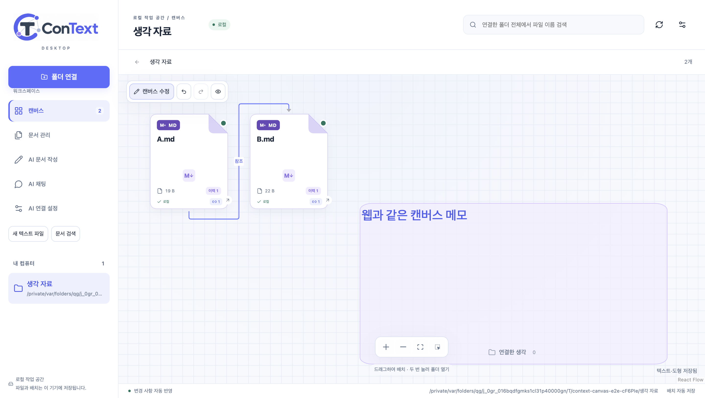

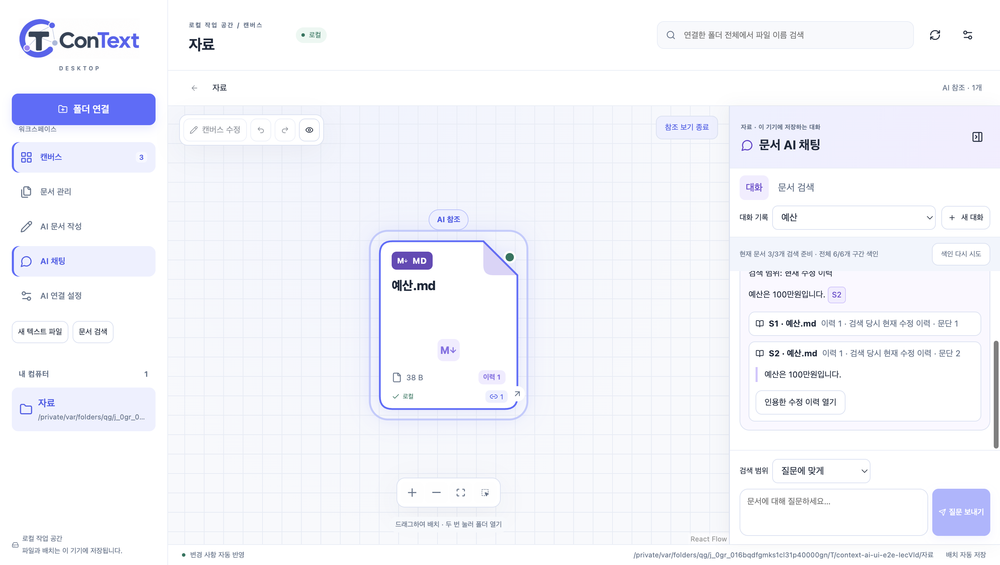

## 실제 폴더의 영역 탐색 추가 검증

2026-10-25 최종 macOS 앱으로 재검증했다. `tests/spatial.spec.ts`는 폴더 진입 전/후 DOM이 같은 캔버스임을 확인하고, 내부 파일·메모·중첩 폴더·영역 선택·실행 취소·영역 전체 이동·두 차례 재시작을 검사한다. 원본 경로·내용과 내부 파일 좌표가 유지된다. 단위 검사에는 기존 좌표의 중첩 투영, 음수 좌표 확장, 200개 한도에서 진입 폴더 우선 표시, 폴더 이름 변경 후 작업 위치 복원과 연결 해제 정리를 포함한다.

공통 선택 좌표 변경의 웹 회귀는 `npm run test:canvas -- --grep 'area selection'`으로 데스크톱·모바일 4개 통과했다. 로그는 `/private/tmp/context-spatial-web-selection.log`다. 기존 백엔드/AI 실호출 결과는 이전 공통화 단계의 결과이며 이번 폴더 UI 변경으로 재호출하지 않았다.

기존 DB 버전 7을 유지하며 기기별 영역 배치 표식과 마지막 작업 폴더·편집 모드를 로컬 설정에 저장한다. 기존 뷰포트는 지우지 않고 새 공간 뷰를 별도 namespace로 저장한다. 영역 탐색·배치 변경은 원본 폴더·파일의 경로를 유지한다. 명시적인 파일 드롭 이동은 아래 별도 항목을 따른다.

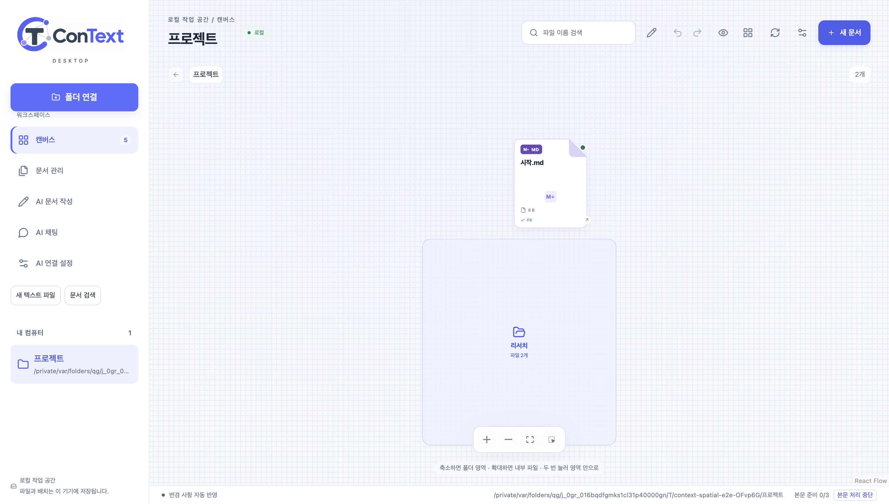

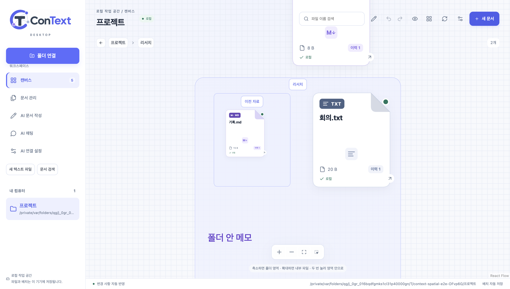

## 폴더 영역 밀도 추가 검증

자동 폴더를 계속 오른쪽으로 밀던 배치를 가까운 여러 행으로 바꿨다. 최소 영역은 400×320, 영역 간 간격은 캔버스 좌표 48이다. 내부 파일·메모 경계가 크면 영역도 확장된다. 직접 배치한 영역은 유지하고, **모아 정렬**은 현재 폴더에 표시된 영역만 모아 저장한다. 되돌리면 정렬 직전 배치로 돌아온다. 원본 파일 경로와 폴더 안의 좌표를 바꾸지 않는다.

단위 검사는 9개 영역의 행 배치·비겹침, 수동 영역 보존, 정렬 후 내부 좌표 보존, 새 뷰포트 namespace의 재시작 복원을 확인한다. 실제 앱 검사는 9개 폴더의 버튼이 모두 뷰포트 안에 있는지와 정렬/되돌리기를 확인한다.

초기 전체 검사에서 새 요약 파일의 관계가 저장돼도 연결선이 빠지는 간헐적 표시 실패를 관측했다. 새 카드의 크기 관측 알림을 막으면 같은 증상이 재현되며, 관계가 생길 때 연결점을 직접 다시 측정하도록 보완했다. 이 조건에서 수정 전 실패(`/private/tmp/context-compact-resize-baseline.log`), 수정 후 통과(`/private/tmp/context-compact-resize-fixed.log`)를 확인하고 전체 검사에도 해당 조건을 유지했다. 마우스 드래그 검사는 편집 모드 반영과 카드의 안정된 위치를 기다린 뒤 시작하도록 보완했다.

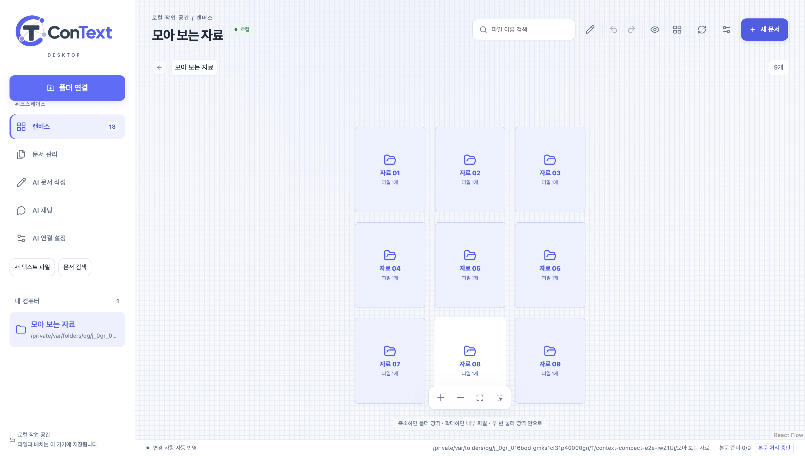

## 전체 폴더 이름과 같은 크기의 대표 카드

물리 폴더는 이름 길이에 맞춰 대표 카드 공간을 확보하고 줄바꿈해 전부 표시한다. 같은 폴더에 파일·하위 폴더가 함께 있으면 파일을 대표 카드의 가로·세로와 같은 크기로 확대한다. 내부 내용을 담는 폴더 영역 전체는 더 클 수 있다. 파일만 있는 폴더는 기본 크기로 표시한다.

확대 배율은 저장된 좌표와 분리한다. 파일·영역 이동은 역변환해 저장하고, 메모/도형의 위치·크기·글자 및 리사이저에도 같은 배율을 적용한다. 원본 파일의 경로·내용은 보존한다. 전체 42개 로컬 검사에는 혼합 배치의 크기·비겹침·내부 좌표 보존, 기존 뷰 보존과 큰 카메라 좌표 복원, 유한하지 않은 좌표 거부를 포함한다. 새 공간 뷰는 `:spatial:readable`에 저장한다.

최종 E2E는 파일 이동 직후의 실제 화면 위치를 폴더 탐색 후 복원한 화면 위치와 비교한다. 저장 좌표와 확대된 화면 좌표를 같은 값으로 가정하지 않는다. 웹에서는 선택적으로 폴더 라벨을 숨기고 배율에 맞게 리사이저 한도를 적용하는 공통 컴포넌트를 검사했다. 웹의 기본 동작은 기존 배율 1을 사용한다.

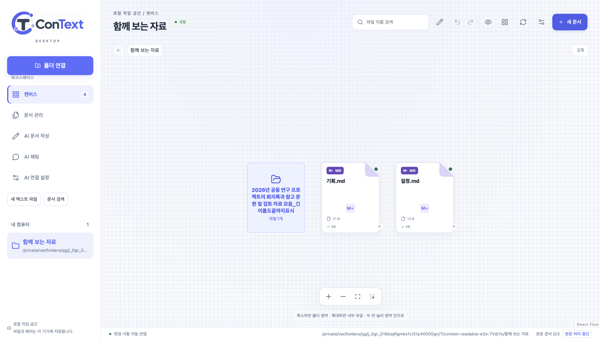

## 폴더 박스 크기 유지와 실제 파일 드롭

**캔버스 수정** 전후 폴더 박스의 크기·위치·카메라는 그대로 유지한다. 닫힌 폴더의 내부 파일·중첩 폴더·메모는 숨기되, 배치 계산은 내부 내용의 전체 경계와 저장 좌표를 보존한다. 별도 이동 손잡이를 제거하고 박스 배경이나 중앙 대표 카드 자체를 끌어 이동한다. 대표 카드를 두 번 누르면 내부 작업으로 진입한다. 별도 **안으로** 버튼은 표시하지 않는다.

파일을 다른 물리 폴더에 놓으면 `moveFileToFolder`가 실제 디스크 경로를 변경한다. 렌더러는 파일·대상 폴더 ID와 예상 원래 폴더를 전달한다. 같은 작업 공간·일반 파일/디렉터리·현재 원래 폴더·경로 제외 설정·유한 좌표를 검사하며, 링크·다른 작업 공간·오래된 원래 경로를 거부한다. 같은 이름이 있으면 덮어쓰지 않는다. 현재 이름을 그대로 보존하며 entry/document ID와 수정 이력을 유지한다. 대상의 파일·메모를 피한 빈 위치를 배정하고, 되돌리기/다시 실행은 실제 경로와 해당 폴더의 저장 좌표를 함께 복원한다. 여러 파일을 옮기다 하나가 실패하면 앞서 완료한 파일마다 개별 되돌리기가 가능하다.

로컬 검사는 20개 내부 파일을 가진 폴더를 옮겨도 전체 내용 크기를 유지하는지와 숨긴 좌표의 역변환, 공백으로 시작하는 실제 이름, 기존 파일·메모를 피한 배치, 이름 충돌·잘못된 대상·링크·제외 경로·잘못된 좌표·재시작을 포함한다. 패키징 앱의 새 시나리오는 편집 시작/종료 전후 실제 박스 경계·카메라 일치, 손잡이 부재, 박스 배경/대표 카드 드래그, 숨겨진 내부 항목, 드롭 대상 강조, 이동 후 디스크 내용과 이전 경로 제거, 실제 실행 취소/다시 실행, 충돌 보존과 재시작을 검사한다.

편집 모드만 전환할 때는 카메라를 자동 이동하지 않는다. 물리 폴더 유무에 상관없이 화면 배율을 유지하며, 연결선 드래그와 파일 드롭을 포함해 전체 패키징 앱 검사를 실행했다.

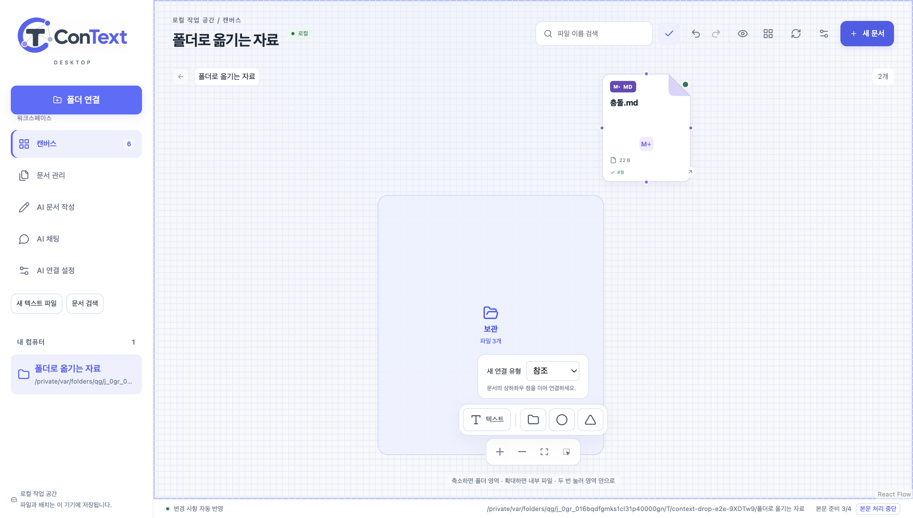

## 웹과 같은 데스크톱 상단

웹·데스크톱이 `WorkspaceHeader`를 함께 렌더링한다. 데스크톱의 실제 React Flow 캔버스는 작업 영역 상단 끝까지 채운다. 제목·검색·도구·경로 버튼은 캔버스 위의 투명 오버레이에 표시하며, 빈 공간의 포인터 입력은 아래 캔버스로 전달한다. 새로 여는 폴더·검색 결과는 측정한 오버레이 높이를 반영해 도구 아래에 배치한다. 도구 높이만 바뀌어도 사용 중인 카메라를 자동 이동하지 않는다. 첫 화면은 애니메이션 없이 즉시 배치하며, 폴더 이동의 목적지 카메라는 UI 상태와 저장소에 함께 반영해 검색을 연달아 열고 닫아도 해당 위치를 복원한다. 편집 도구는 기존 캔버스 상태와 실행 취소 기록을 사용한다.

1440px와 1000px 창의 패키징 앱 화면을 확인했다. 실제 캔버스와 작업 영역의 상단 좌표가 같고 헤더 배경색은 투명하다. 상단 빈 공간을 마우스로 끌면 실제 캔버스 viewport가 이동한다. 좁은 창에서는 제목과 도구 행을 나눠 모든 버튼을 표시하며 가로 넘침이 없다. 상단 **새 문서**로 실제 빈 Markdown 파일 생성과 텍스트 편집기 열기를 확인했고 렌더러 오류는 없었다. 로그는 `/private/tmp/context-overlay-preview.log`이다.

검색으로 전환할 때 공간 탐색의 저장 카메라를 검색 목록에 적용해 결과가 화면 밖에 생기는 경우도 수정했다. 검색 화면은 별도 초기 카메라를 사용하고 물리 폴더 탐색의 저장 배치·카메라는 유지한다. 기존 전체 E2E가 폴더 탐색 후 파일 이름 검색·지우기·파일 배치·재시작을 검사한다.

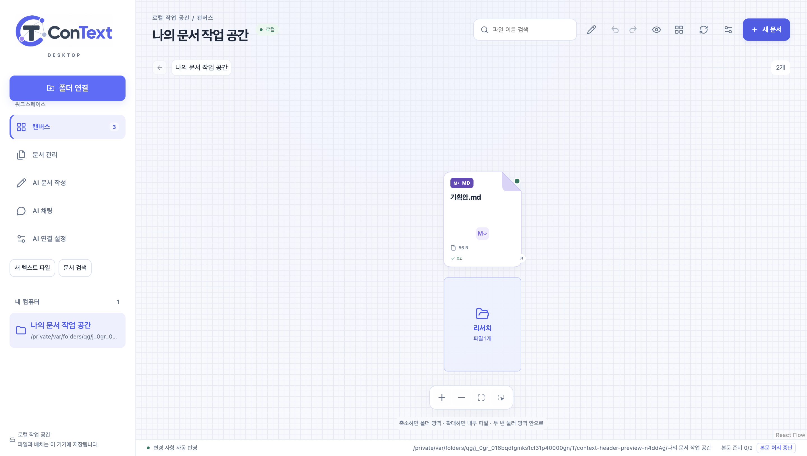

[1000px 폭의 창에서 도구 행이 제목 아래로 내려간 화면](images/desktop-web-header-narrow.png)


## AI 대화와 본문 검색을 한 입력으로 통합

공통 `ChatPanelView`에서 대화/검색 모드와 전환 탭을 제거했다. 질문을 제출하면 같은 범위·기준일로 검색한 근거를 먼저 표시하고 AI 답변을 요청한다. 답변 근거의 순서와 인용 번호를 유지하고 다른 검색 발췌도 문서 버전·본문 구간으로 중복을 제거해 함께 표시한다. AI 연결 실패 시에도 찾은 문서와 인용 원문 열기를 유지한다. 다음 질문과 대화 전환 전 검색 근거를 패널에 보관하므로 앞선 검색 카드가 사라지지 않는다. 이 임시 근거 목록은 패널 메모리에 있으며, 앱/페이지 재시작 후에는 기존 AI 메시지에 영구 저장된 출처를 사용한다.

데스크톱의 별도 본문 검색 메뉴·패널과 긴 소개·모드별 안내를 제거했다. 새 대화·설정·전송·원문 열기·접기·재시도는 아이콘이고 툴팁·접근 가능한 이름을 유지한다. 대화 제목과 문서 이름·답변·필요한 오류는 텍스트로 읽을 수 있다. 색인 진행과 검색 경고는 작은 지표·아이콘으로 표시하며 범위·날짜는 검색 설정에서 펼친다. AI 연결 설정 아이콘은 기존 ChatKHU 설정을 연다. 캔버스 상단의 파일 이름 필터는 별도로 유지한다.

웹·모바일 14개 검사는 통합 입력당 검색/질문 요청, 분리 모드 부재, 질문과 날짜 범위 전달, 미인용 검색 문서 유지, 빈 결과의 참조 강조 해제, 대화 접기/초안/기록 유지, 중복 요청 ID 재사용·수동 재시도, AI 미설정 시 원문 열기와 다음 질문 후 이전 검색 카드 유지, AI 실패 후 원문 읽기 오류 표시를 확인한다. 비동기 재전송 검사는 실제 두 번째 요청 접수를 기다린 뒤 요청 ID를 비교한다. 실제 유료 호출은 대역이며 자동 재전송을 추가하지 않았다.

통합 패널 단계의 패키징 앱 전체 12개 E2E도 통과했다. 실제 로컬 파서·색인·SQLite·IPC로 본문을 찾고, AI 미설정 상태에서 과거 인용을 열어 비교·복원한다. 합성 AI 답변에서는 캔버스 참조·원본 삭제 후 스냅샷·재시작 대화 복원을 확인한다. 이전 전체 실행에서 폴더 재시작 후 메모 표시 검사가 한 번 실패했고(`/private/tmp/context-unified-packaged.log`), 같은 앱의 추적 재검사 1개와 최종 전체 검사 12개에서는 통과했다. 파일·폴더 실행 코드는 이번 통합에서 변경하지 않았으며 해당 간헐적 관측의 원인은 확정하지 않았다.

1440px·1000px 창에서 통합 패널의 검색된 두 문서, 아이콘 명령, Enter 전송, 인용 펼치기, 기준일 설정과 가로 넘침 여부를 별도로 확인했다. 원본 파일 내용은 유지되며 렌더러 오류는 없었다. 로그는 `/private/tmp/context-unified-preview.log`다.

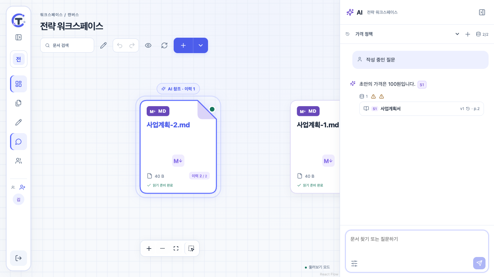

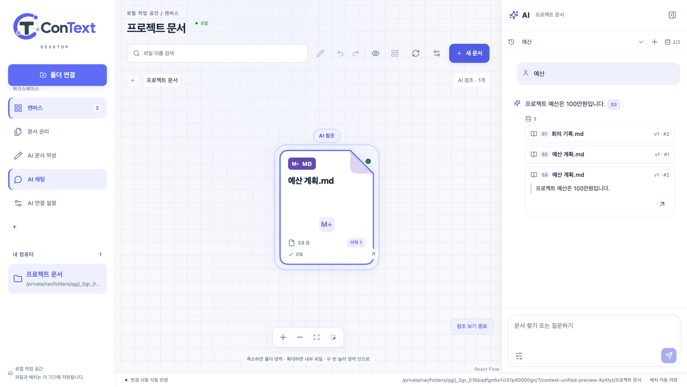

[1000px 창에서 검색 설정을 펼친 화면](images/unified-ai-desktop-narrow.png)


## 파일별 연결 해제와 다시 연결

미리보기의 원본 파일 작업과 문서 관리의 각 파일 행에 연결 해제 아이콘을 추가했다. 원본 바이트를 옮기거나 삭제하지 않고 `local_settings`에 작업 공간/entry ID별 연결 상태를 저장한다. DB 버전은 7을 유지한다. 문서 관리의 연결 해제 목록에서 다시 연결할 수 있으며, 원본이 현재 없으면 버튼을 비활성화한다. 문서·이미지 등 일반 파일에 적용하고 폴더·링크·다른 작업 공간의 ID는 거부한다.

해제한 파일은 캔버스·일반 파일 목록·현재/과거/기준일 검색·새 AI 문서 검색·작성의 자동 문서 수집·버전 후보에서 제외한다. 원본 읽기·수정과 배치 API도 해제 상태를 검사한다. 문서 버전·위치·관계·대화 기록을 지우지 않으므로 기존 인용은 저장된 스냅샷으로 열며 연결 해제 상태를 표시한다. 과거 대화와 초안의 저장 내용은 유지한다. 다시 연결하면 같은 ID·배치·버전·연결선을 복원하며 해제 중 외부에서 바뀐 파일은 새 버전으로 읽는다.

44개 로컬 단위/통합 검사는 파일 감시/재스캔·외부 이름 변경·재시작 후의 해제 유지, 전 검색 범위와 작성의 문서 수집·버전 후보·참조/관계 제외, 원본과 기존 인용 보존, 다른 작업 공간/폴더 거부, 재연결 시 ID/좌표/이력/관계 복원과 전체 작업 공간 해제 시 설정 정리를 포함한다. 처리 중인 읽기를 일시 중지한 뒤 연결을 해제하고 파싱을 완료시켜도 새 버전·색인에 등록되지 않으며 다른 파일 처리 실패로 집계되지 않는 것을 확인했다. 로그인 대역의 로컬 콜백 포트가 필요한 전체 검사는 포트 접근이 가능한 실행 환경에서 통과했다.

최종 macOS 패키징 앱의 13개 E2E가 모두 통과했다. 새 시나리오는 실제 원본·SQLite·IPC·파서로 미리보기 해제, 문서 관리의 이미지 해제, 통합 검색 제외, 새로고침/재시작 유지, 두 파일 재연결과 원래 ID·좌표·버전/원본 내용 보존을 확인한다. 웹·공통 컴포넌트와 파서는 변경하지 않았으며 웹의 이전 14개 결과는 통합 패널 단계 결과로 구분한다.

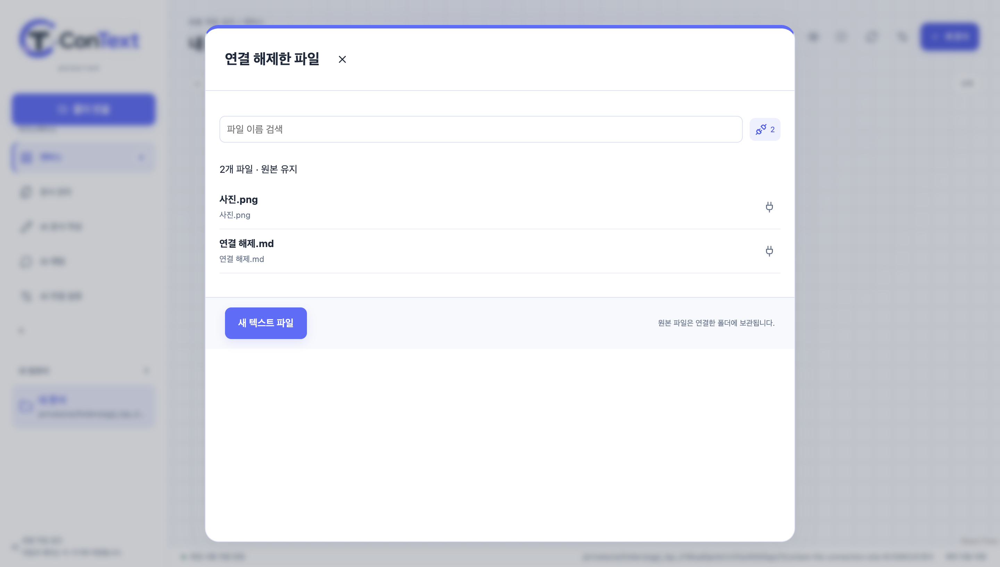


## 내 컴퓨터의 연결 폴더 전체 해제

왼쪽 **내 컴퓨터**의 연결 폴더마다 전체 해제 아이콘을 표시한다. 열지 않은 폴더도 목록에서 직접 해제할 수 있다. 폴더 설정의 기존 전체 해제 동작을 같은 화면 전환 핸들러로 연결했으며, 원본 폴더·파일과 하위 파일은 보존한다. 확인 창은 대상 폴더 이름과 앱의 배치·메모·초안·대화·문서 이력·검색 자료를 정리하는 범위를 표시하고 취소를 기본값으로 한다. 전체 해제는 해당 작업 공간에 적용되며 다른 연결 폴더는 유지한다.

다른 연결 폴더를 해제할 때는 현재 캔버스·채팅 초안을 유지한다. 현재 폴더는 캔버스 저장을 완료한 뒤 해제하고, 삭제된 작업 공간의 저장 콜백을 비운 후 남은 연결 폴더를 연다. 마지막 폴더를 해제하면 열린 작업 화면을 정리하고 시작 화면으로 돌아간다. 해제한 폴더는 재시작 후 자동으로 다시 연결하지 않는다.

새 E2E는 두 연결 폴더에서 대상 이름·취소 기본값·취소 시 상태 유지, 다른 폴더 해제 후 현재 파일/채팅 초안 유지, 재연결한 현재 폴더 해제 후 남은 폴더로 이동, 마지막 폴더 해제와 재시작 후 빈 목록, 두 원본과 중첩 원본의 바이트 보존을 확인한다. 아이콘은 항상 표시하고 접근 가능한 이름/툴팁을 제공한다. 이름은 줄바꿈하며 경로는 한 줄로 표시해 목록이 불필요하게 늘어나지 않는다.

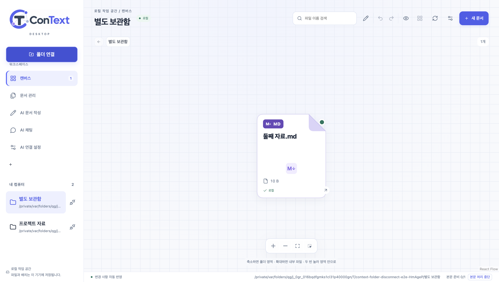


앞선 폴더 전체 해제 단계의 앱 전체 실행은 14개 중 13개가 통과했다. 기존 폴더 탐색 검사에서 미리보기 닫기 직후 대화상자가 남아 캔버스 버튼을 누르지 못한 한 차례 실패를 관측했고, 소스나 실행 파일을 바꾸지 않은 해당 시나리오 재검사는 통과했다(7.8s). 전체 해제 시나리오는 개발 실행과 최종 패키징 앱에서 각각 통과했다. 이전에 기록한 폴더 탐색 간헐 실패와 함께 검증 범위를 구분하며 이를 수정한 것으로 표시하지 않는다.


## 참조 목록 기본 접힘과 공간을 유지하는 참조 확대

공통 `SourceExcerpts`는 답변 하단의 화살표로 펼치는 기본 접힘 목록이다. 기존 출처 순서를 유지하며 인용 버튼은 전체 목록과 해당 발췌를 자동으로 펼친다. 목록을 열고 닫는 동작은 캔버스 초점을 다시 요청하지 않는다. 검색 경고·기준일은 접힘과 별개로 표시한다.

데스크톱은 참조 ID로 기존 파일을 걸러 평면으로 재배치하던 동작을 제거했다. 기존 공간 배치와 파일·폴더·메모·연결선을 유지하고 참조 대상의 공간 좌표 경계로 카메라만 확대·이동한다. 기본 폴더 탐색의 좌표/크기와 검색용 현재 문서 버전은 변경하지 않는다. 카메라는 상단 도구 높이를 반영하고 참조 중에는 저장 화면을 덮어쓰지 않는다. 참조를 종료하면 확대 전 화면으로 돌아가며 명시적 폴더 이동은 새 목적지를 우선한다.

표시 한도 밖의 참조는 원래 보이던 항목을 빼지 않고 대상과 조상 폴더를 임시로 추가한다. 기존 배치와 폴더 좌표계를 그대로 유지하고 새 폴더만 빈 자리에 배치한다. 로컬 검사에는 200개 기존 항목과 표시 범위 밖의 문서·중첩 조상을 함께 넣어 기존 기하/입력 불변, 정상 카드 크기와 새 좌표 투영을 확인한다. 기존 폴더에 추가되는 참조도 박스와 주변 파일·메모의 좌표를 바꾸지 않는다.

최종 앱 전체 15개 E2E가 통과했다. 참조 전후 카드 위치·크기 동일, 주변 카드의 같은 DOM 유지와 연결선 보존, 목록 접기·펼침 시 카메라 불변, 저장된 카메라 불변, 참조 종료 후 이전 화면 복원을 확인한다. 별도 실제 폴더 시나리오는 내부의 주변 파일·메모·폴더 박스/경로 유지와 원본 보존을 확인한다. 웹/모바일 14개도 기본 접힘·더 보기·인용 자동 펼침·기존 검색/실패/이력 흐름을 통과했다. 실제 유료 호출 대신 기존 합성 AI 경계만 대체했다.

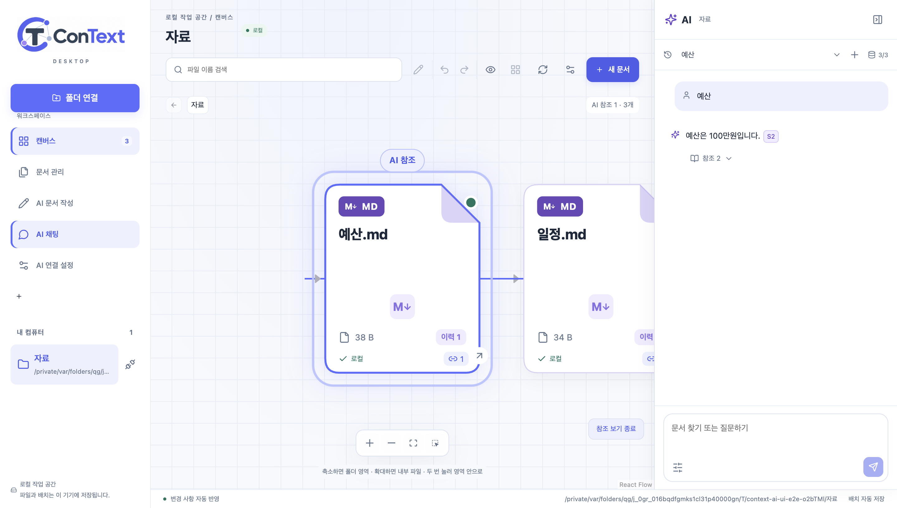

[참조 목록을 펼친 화면](images/desktop-reference-expanded.png)

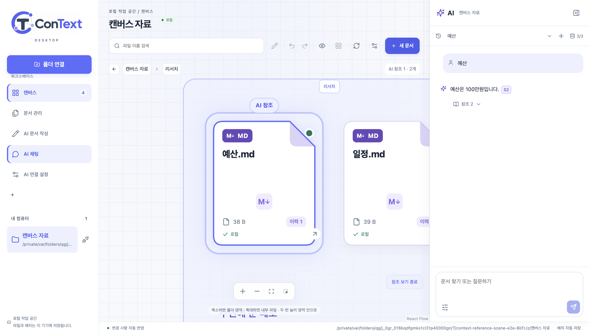
