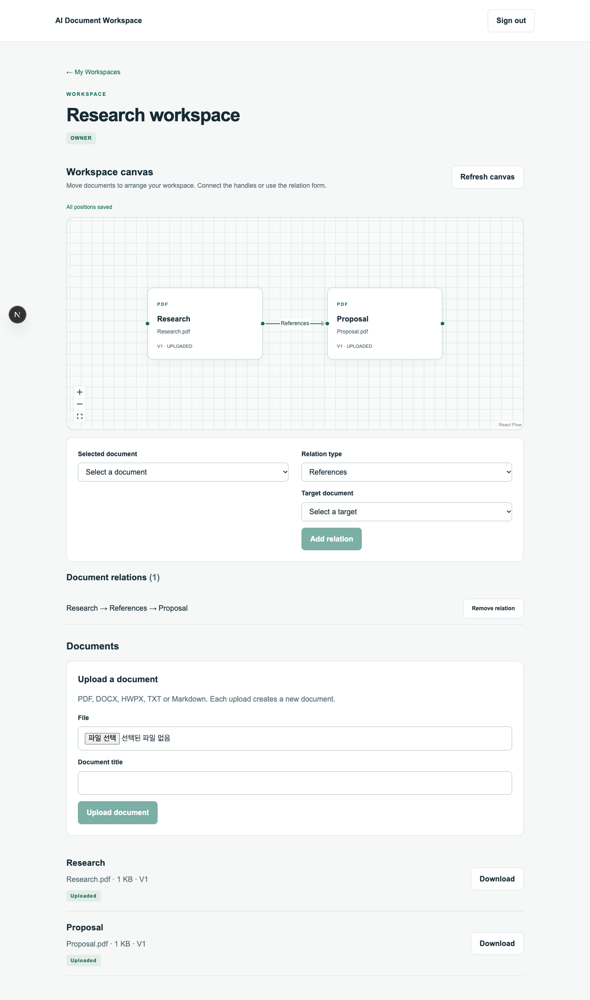

# Phase 3 — Canvas Workspace

Phase 2의 실제 S3 검증을 통과한 뒤 React Flow 12.12.0으로 Workspace 상세에 문서 캔버스를 추가했다. 소스는 현재 레포에서 수정할 수 있으며 Docker bind mount에 반영된다. Phase 4 파싱·worker 및 Phase 5 버전 연결은 구현하지 않았다.

## 사용 방법

1. Google 로그인 후 Workspace를 연다. 기존 문서가 캔버스 카드로 나타난다. 문서가 없다면 아래 Upload a document에서 업로드한다.
2. OWNER/EDITOR는 카드를 드래그해 배치한다. 놓은 뒤 잠시 후 자동 저장되며 `All positions saved`를 확인하고 페이지를 떠난다.
3. 키보드는 카드에 Tab으로 이동 → Enter로 선택 → 방향키로 이동한다. Shift+방향키는 더 크게 이동한다.
4. 배경을 드래그해 팬하고 휠/핀치 또는 +/− 버튼으로 줌한다. Fit View 버튼으로 문서를 한눈에 본다.
5. 카드 선택 또는 Selected document 선택기로 문서 정보를 보고 Download original로 원본을 받는다.
6. 관계 유형을 선택한 뒤 출발 카드 오른쪽 핸들을 도착 카드 왼쪽 핸들로 연결한다. 모바일·키보드에서는 Selected document와 Target document를 골라 Add relation을 누를 수 있다.
7. Remove relation은 관계선만 삭제한다. 원본 문서와 S3 파일은 유지한다.

VIEWER는 위치·관계를 변경할 수 없지만 줌/팬, 문서 선택, 다운로드를 사용할 수 있다. 실제 쓰기 제한은 FastAPI가 수행한다. 업로드·재시도·완료 확인과 기존 문서 목록은 캔버스 아래에 유지한다.



[모바일 화면 예시](images/phase-3-mobile.png). 이미지는 브라우저 테스트 fixture의 예시 문서이며 사용자의 실제 문서가 아니다.

## 저장과 동시 편집

- 좌표는 워크스페이스 멤버가 공유한다. 새로고침과 다른 브라우저에서도 서버 좌표로 복원한다.
- 최초 위치가 없는 문서는 생성 순서와 ID 순서대로 격자에 배치한다. 첫 이동 때 좌표 행을 생성한다. 문서를 새로 업로드하면 캔버스가 갱신된다.
- 변경된 노드만 최대 100개씩 PATCH한다. 클라이언트는 저장 요청을 직렬 처리하고 이동 중 생긴 후속 변경도 이어서 저장한다. DB는 배치 전체의 소속을 검증하고 한 transaction으로 저장한다.
- 같은 문서를 여러 멤버가 동시에 이동하면 마지막으로 commit된 좌표가 유지된다. 실시간 협업·접속자 표시·서버 변경 push는 이번 범위 밖이다. Refresh canvas로 다른 멤버의 변경을 가져온다.
- 저장 오류 시 로컬 위치와 미저장 큐를 유지하고 Retry saving positions를 제공한다. 미저장 상태에서 Refresh canvas는 비활성화된다. 브라우저 새로고침/닫기에는 beforeunload 경고를 요청한다. 브라우저 정책에 따라 경고가 제한될 수 있고 앱 내부 링크 이동에는 자동 차단을 하지 않으므로 저장 완료 후 이동한다.
- 줌/팬은 현재 페이지의 탐색 상태이며 DB에 저장하지 않는다. 다음 진입은 Fit View로 시작한다.

## 데이터 모델

Migration: `backend/migrations/versions/0003_canvas_workspace.py`.

| 모델 | 필드와 제약 |
|---|---|
| document_positions | document_id PK/FK, x, y, updated_by, updated_at. 좌표 범위 −100,000~100,000 |
| document_relations | id, workspace_id, source_document_id, target_document_id, relation_type, created_by, created_at |
| documents 추가 제약 | UNIQUE(workspace_id, id), 관계 양 끝의 소속을 DB에서 검증하는 복합 FK 대상 |

관계는 source → target 방향이다. REFERENCE는 source가 target을 참조한다는 뜻이고, DERIVED_FROM/GENERATED_FROM은 source가 target에서 파생/생성되었다는 뜻이다. RELATED_TO도 저장되는 방향을 유지한다. 자기 연결을 거부하고 같은 source/target/type 조합은 하나만 저장한다. 같은 문서 쌍에 서로 다른 유형이나 반대 방향 관계는 가능하다. 모든 관계는 양 끝이 동일 Workspace에 있어야 하며 API와 DB 복합 FK가 모두 보장한다.

관계 생성자와 좌표 최종 수정자를 기록한다. 삭제 이력/전체 Activity 로그는 후속 범위다. VERSION 관계를 임의로 생성해 버전 시스템을 우회하지 않도록 이번 enum에는 VERSION을 포함하지 않았다.

## API

모든 요청은 Supabase Bearer 토큰이 필요하다. WorkspaceMember가 없으면 존재하지 않는 Workspace와 동일하게 404를 반환한다.

| Method | Path | 권한 / 응답 |
|---|---|---|
| GET | /api/workspaces/{id}/canvas | 모든 멤버. documents, positions, relations snapshot |
| PATCH | /api/workspaces/{id}/canvas/positions | OWNER/EDITOR. 저장된 좌표 배열 반환 |
| POST | /api/workspaces/{id}/relations | OWNER/EDITOR. 생성 또는 기존 동일 관계 반환, 201 |
| DELETE | /api/workspaces/{id}/relations/{relation_id} | OWNER/EDITOR. 삭제 성공 204, 없거나 다른 Workspace 관계는 404 |

위치 요청:

```json
{"positions": [{"document_id": "문서 UUID", "x": 120.5, "y": -40}]}
```

관계 요청:

```json
{"source_document_id": "출발 문서 UUID", "target_document_id": "도착 문서 UUID", "relation_type": "REFERENCE"}
```

좌표의 NaN/Infinity, 범위 초과, 배치 내 중복 문서, 빈 배치, 100개 초과 배치는 422다. 배치 중 한 문서라도 다른 Workspace에 속하면 전체 저장을 거부한다. snapshot은 문서 최대 1,000개까지 지원하며 초과하면 413을 반환한다. 캔버스에서 일부 문서를 조용히 누락하지 않으며 기존 목록은 계속 사용할 수 있다.

## 실행과 외부 설정

Phase 3에 새로운 외부 서비스·키는 필요 없다. 기존 PostgreSQL, Supabase, S3를 사용한다.

```bash
docker compose --env-file .env.development up --build -d
```

이미 생성된 frontend_node_modules 볼륨에는 이미지 재빌드만으로 새 라이브러리가 반영되지 않을 수 있다. 이 작업 환경은 아래 갱신까지 완료했다. 다른 기존 개발 환경에서 React Flow를 찾지 못하면 다음 순서로 실행한다.

```bash
docker compose --env-file .env.development stop frontend
docker compose --env-file .env.development run --rm --no-deps frontend npm ci
docker compose --env-file .env.development up -d frontend
```

개발 DB에는 migration head를 적용했으며 기존 문서·워크스페이스 데이터를 삭제하지 않았다. 검증 결과는 [phase-3-verification.md](phase-3-verification.md), S3 실버킷 및 남은 테스트 객체 정리는 [Phase 2 검증 기록](phase-2-verification.md#aws-재검사-통과--2026-10-07-2227-kst)에 있다.

구현 참고: [React Flow custom nodes](https://reactflow.dev/learn/customization/custom-nodes), [controlled interactivity](https://reactflow.dev/learn/concepts/adding-interactivity), [save and restore](https://reactflow.dev/examples/interaction/save-and-restore).
