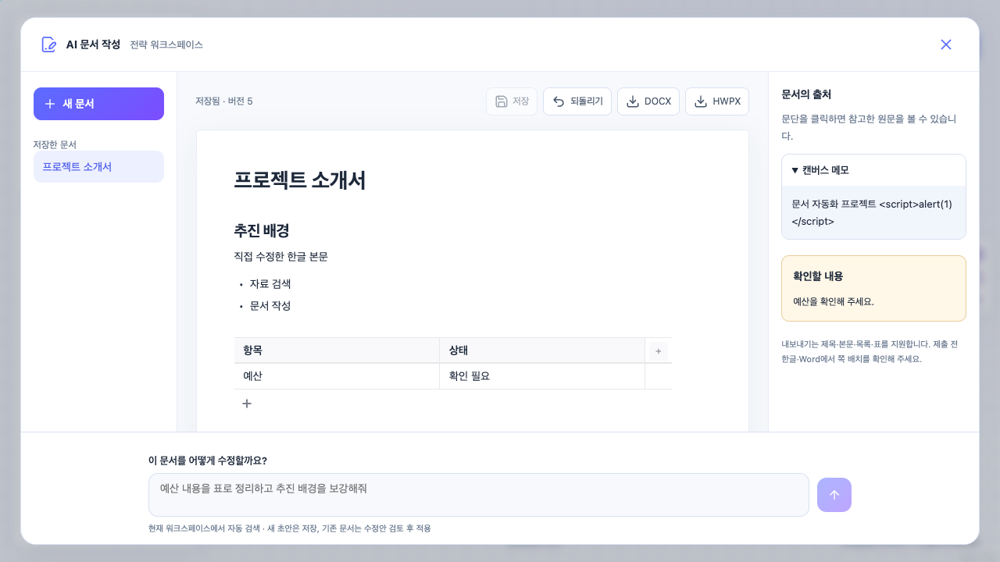

# AI 문서 작성

검증 결과와 적용 기록은 [검증 기록](phase-9-verification.md)에 있다.

## 사용하는 방법

1. 워크스페이스 왼쪽 메뉴에서 **AI 문서 작성**을 연다.
2. “관련 자료로 대회 제출용 프로젝트 소개서를 작성해줘”처럼 요청한다. 매번 파일이나 폴더를 선택할 필요가 없다.
3. 생성된 초안은 워크스페이스에 저장된다. 제목·본문·소제목·글머리 목록·표를 Editor.js에서 직접 편집하고 **저장**을 누른다.
4. 문단을 누르면 오른쪽에서 연결된 원문을 확인한다. 모바일에서는 본문 아래에 출처가 표시된다.
5. 하단에서 수정 요청을 보내면 현재 문서와 수정안, 수정안의 출처를 비교할 수 있다. **수정안 적용**을 눌러야 현재 문서가 바뀐다. 적용 또는 직접 저장 후 **되돌리기**를 사용할 수 있다.
6. **DOCX** 또는 **HWPX**로 내려받는다. 직접 편집한 변경은 먼저 저장한다. 검토 중인 수정안은 적용하기 전까지 다운로드에 포함되지 않는다.
7. 문서를 열고 상단 **문서 삭제**를 누른다. 확인창의 **삭제하기**를 누르면 본문·수정안·저장 이력이 함께 삭제된다. 취소하거나 Escape를 누르면 편집하던 문서로 돌아간다. 삭제는 되돌릴 수 없다.

문서 목록과 내용은 같은 워크스페이스의 팀원에게 공유된다. OWNER·EDITOR는 작성 및 편집, VIEWER는 읽기와 다운로드를 사용할 수 있다. 저장하지 않고 닫거나 다른 문서로 이동할 때는 변경을 버릴지 확인한다.

삭제도 OWNER·EDITOR만 가능하다. 다른 팀원이 먼저 저장했다면 최신 문서를 다시 열어 확인해야 삭제할 수 있다. 삭제에 실패하면 미저장 편집 내용은 유지한다. 원본 자료·메모·대화, 이미 내려받은 파일과 다른 문서에 인용된 발췌는 그대로 남는다.



## 구현 구조

```text
사용자 요청
  → 서버의 워크스페이스 멤버십 검사
  → 기존 RAG 문서 검색 + 메모·최근 대화·기존 초안 탐색
  → ChatKHU에 요청과 출처 발췌, 수정 시 현재 문서 전달
  → JSON 문서 구조 및 출처 ID 검사
  → 초안 저장 또는 검토용 수정안 저장
  → Editor.js 편집 / 출처 표시
  → 공통 문서 구조 → DOCX / HWPX
```

- API: `backend/app/api/writing.py`; 공통 문서 구조: `backend/app/schemas/writing.py`.
- 작성·근거 수집: `backend/app/services/writing.py`. 기존 `AIService`와 Mindlogic gateway 설정을 재사용한다. 키는 서버에서만 사용한다.
- 저장: `writing_drafts`, Alembic `0011_ai_writing`. 본문, 원문 발췌, 확인 사항, 검토 중인 수정안, 최근 20개 저장 스냅샷을 보관한다. 최신 100개 문서를 목록에 표시한다.
- 프런트엔드: `frontend/features/writing/`. Editor.js는 브라우저에서 동적으로 불러온다. 서버 저장과 내보내기는 같은 블록 구조를 사용한다.
- DOCX: 기존 `python-docx` 렌더러를 재사용한다. HWPX: 고정한 `python-hwpx==6.8.0`의 기본 문서 템플릿에 제목·본문·표를 작성하고 스키마 검사 후 반환한다.

자동 탐색 범위는 **현재 워크스페이스에서 접근 가능한 자료**다. 컴퓨터 전체나 연결되지 않은 외부 드라이브를 읽지 않는다. 문서는 기존 의미/키워드 검색을 사용하고, 최근 메모 50개·완료된 대화 메시지 40개·기존 초안 20개 중 요청 키워드와 관련된 후보를 우선 선택한다. 추가 후보는 최대 6개이며, 수정 시 기존 출처도 문맥 예산 내에서 유지한다. 모델에 보낼 전체 발췌는 최대 24,000자로 제한한다. 검색 색인이 미완료이거나 의미 검색이 불가능하면 화면에 알린다.

출처는 작성 당시의 발췌 스냅샷이다. AI가 반환한 출처 ID가 제공한 근거에 존재하는지는 검사하지만, 문장이 원문의 의미와 일치하는지 자동으로 보증하지는 않는다. 원문에 없는 사실·수치·일정은 `[확인 필요]`로 쓰도록 요청하며 화면에 확인 사항을 표시한다. 직접 편집한 내용은 기존 출처와 다시 대조해야 한다.

요청 재시도에는 UUID를 재사용한다. 새 문서 생성은 사용자·워크스페이스·요청 ID로 중복 저장을 막는다. 기존 문서 수정은 revision과 행 잠금을 사용한다. 다른 사용자가 먼저 저장했다면 409로 알려 덮어쓰기를 막는다. 다운로드도 요청한 revision이 달라지면 다시 열도록 안내한다.

## API

기준 경로: `/api/workspaces/{workspace_id}/writing`

| 메서드 / 경로 | 동작 |
| --- | --- |
| `GET /` | 저장한 문서 목록 |
| `POST /` | `{request_id, prompt}`로 초안 작성·저장 |
| `GET /{id}` | 본문·출처·검토안 읽기 |
| `PATCH /{id}` | `{revision, content}`로 직접 편집 저장 |
| `DELETE /{id}?revision=N` | 확인한 버전의 작성 문서 삭제, 성공 시 204 |
| `POST /{id}/propose` | `{request_id, prompt, revision}`로 AI 수정안 생성 |
| `POST /{id}/accept` | `{revision}`으로 수정안 적용 |
| `POST /{id}/reject` | `{revision}`으로 수정안 폐기 |
| `POST /{id}/undo` | `{revision}`으로 이전 저장 내용 복원 |
| `GET /{id}/export/docx?revision=N` | 현재 저장본 DOCX 다운로드 |
| `GET /{id}/export/hwpx?revision=N` | 현재 저장본 HWPX 다운로드 |

작성은 동기 요청이다. 작성 중 화면에 진행 안내를 표시하며, 실패하면 요청 내용을 남겨 재시도할 수 있다. 완료 전 브라우저를 닫아도 이어지는 백그라운드 작업이나 실시간 공동 타이핑은 지원하지 않는다.

## 실행 및 검증 명령

서버의 기존 `MINDLOGIC_API_KEY`, `MINDLOGIC_BASE_URL`, `AI_MODEL`, `AI_EMBEDDING_MODEL`을 사용한다. 키가 없거나 응답 검증에 실패하면 가짜 문서를 대신 만들지 않고 오류를 표시한다.

기존 Docker 개발 환경에서 의존성 갱신이 필요하면:

```bash
docker compose --env-file .env.development build backend frontend worker dispatcher
docker compose --env-file .env.development run --rm --no-deps frontend npm ci
docker compose --env-file .env.development up -d
```

백엔드 시작 시 Alembic이 새 테이블을 적용한다. 기존 DB를 사용하는 경우 업데이트 전에 백업한다. 기존 `.env.development`와 데이터 볼륨을 덮어쓰거나 삭제하지 않는다.

```bash
# 전체 백엔드: 격리 DB / Redis / 한글 글꼴 포함
docker compose --env-file .env.development -f docker-compose.yml -f docker-compose.test.yml --profile test run --rm --build backend-test

# frontend 디렉터리
npm run test:writing
npm run test:rag
npm run typecheck
npm run lint
npm run build
```

새 백엔드 테스트는 자동 근거 수집·워크스페이스 분리·중복 요청·잘못된 출처 거절·수정안 검토·동시 편집·되돌리기·VIEWER 권한·DOCX/HWPX 재파싱과 HWPX 스키마 검사를 포함한다. 브라우저 검사는 실제 Editor.js를 사용하며 인증과 AI/API 응답은 fixture로 대체한다. 별도로 합성 시연 메모를 실제 ChatKHU에 보내 생성한 문서의 구조 검증과 양식별 출력·재파싱을 확인했다.

## 현재 범위

3D 화면은 포함하지 않는다. 기존 캔버스 안에 문서 작성 화면을 추가했다. 제목·본문·글머리 목록·일반 표 중심이며, 이미지·병합 셀·각주·정밀 쪽 배치·원본 한글 양식의 완전한 복원·HWP 바이너리 출력은 지원하지 않는다. 출처와 확인 사항은 웹 화면에서 관리하며 내려받는 문서에는 본문을 출력한다. 기존 문서를 열어 원본 파일을 덮어쓰는 기능과도 별개다. Google Docs에 직접 저장하는 기능은 포함하지 않는다.

HWPX의 구조와 본문 재파싱은 검증했지만 한컴오피스 및 Microsoft Word의 실제 페이지 렌더링은 확인하지 않았다. 최종 제출 문서의 글꼴과 쪽 배치는 해당 편집기에서 확인한다.
